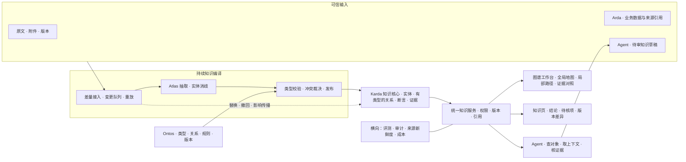

# Karda 知识平台重构：能力图与实施批次

日期：2026-11-24。状态：**owner 已授权设计更新、更新批次并执行**。设计基线为 [160 持续知识架构](../30-design/160-continuous-knowledge-architecture.md)。K0a、K1a、K1b-P1/P2/P3/P4 已完成各自限定范围的实现验证；K0/K1 整批验收仍未完成。带勾选标记及剩余数量的入口为 [17 项执行清单](120-rebuild-execution-checklist-20261124.md)。本文件不变更平台 I1 暂缓、平台配置和真实客户权限边界，也不把旧业务功能当作已验收。各批实际证据见 §70。

## 10. 产品目标与边界

Karda 将原始材料和业务数据编译成能持续更新的知识资产。**同一份带证据的知识，供 Agent 调用、供人读知识页、供人沿大幅图谱探索。** 第一条产品链路选「招标项目 → 条款 → 资质 → 证明材料」；第二场景用 SOP 新旧版本，验证方法可复用。

- **Ontos** 管版本化的类型、关系、约束和推理规则；**Karda** 管知识实例、断言、时间、证据及发布状态。第一版通过带版本的标准契约和本地样例接线；样例验证不记作 Ontos 联调。有关跨产品实例归属的裁定按 KD-205 流程收口。
- **Arda** 持有结构化业务真值，Karda 保存来源引用和有证据的衍生知识。**Atlas** 提供抽取、向量化、精排和生成能力。**Runos** 可按平台协议分发知识工具，Agent 与图谱依旧复用 Karda 的知识服务与可见范围。
- 复用原文检索、断言/实体/证据/原文片段、确认台、工具入口和现有租户授权；正式重用项由 K0 审计后确认。保留 KD-209 的「原文已验证不代表断言已验证」、KD-211 的独立抽取任务与 KD-222 的确认即收录语义。

## 20. 产品能力图

以下为目标架构。图谱工作台应占据独立大画布；能力图上的后续项按批次启用。

## 30. 先进性及验证办法

LLM Wiki 的工作方式作为重构输入：来源、知识页和维护规则分开；摄取分为分析候选与校验发布；目录和反向链接从已发布资产生成；提供仅原文检索、图谱探索、知识体检和审核回存。按[源码对标与采纳清单](90-llm-wiki-source-benchmark-20261124.md)逐项验收，采用已核对的产品行为与设计，自主实现。

| 设计 | 技术要点 | 可证明的价值 |
| --- | --- | --- |
| 知识随材料演进 | 来源版本、依赖关系、差量编译、幂等键和可重放事件；各层投影可从已发布记录重建 | 更换或撤回一份材料，只影响相关知识；能追溯一次变更所影响的页面、边和结论 |
| 知识可辩护 | 断言挂原文锚点、支持/反驳证据及生效区间；区分来源陈述、人员确认和规则推导 | 能回答「依据哪份资料、哪一版、什么时候有效」；证据不足明确返回不足 |
| 图谱能完成工作 | 图谱服务以语义类型和权限限定路径；全局聚合、按需展开局部；边可打开证据侧栏 | 用户从对象找到证据与冲突；不同权限下节点、边、路径、数量与下载均不泄露 |
| 智能体能可靠取用 | 统一知识包：对象 ID、适用范围、有效时间、状态、证据和缺口；词法/向量保底，按意图选结构查询或图增强 | 多 Agent 复用同一知识；复杂检索与文字基线进行同题对照，记录质量、延迟、模型用量 |
| 本体真的参与运行 | 固定语义版本，确定性校验先于发布；记录规则版本、输入和解释路径 | LLM 提出候选；可执行规则由确定性服务验证；区分推导结果与已验证事实 |

首期用 PostgreSQL 和受限图查询承载；独立图数据库、全局 GraphRAG 归纳、全自动推理按基准和实际负载单独决策。图谱渲染库在 K3 依可访问性、交互性能及维护成本选型。离线评测数据和图谱示例均显式标明来源及类别。

## 40. 批次计划

K0 → K1 → K2 → K3；K4 建立在 K2 的稳定知识服务上，可与 K3 独立验证；K5 汇合 K3/K4，随后 K6。每批以一个可独立验收的 PR 为单位；超出一个 PR 的内容拆子批次，各自产出验收证据。K0 后再估工期，依据依赖到位时间和真实样本质量排期。

执行细分：**K0a** 设计/源码盘点/合成基线脚手架；**K0b** 真实来源、人工标注与独立留出集；
**K1a** 无生产依赖的版本化本体校验与安全图投影；**K1b** DDL/Prisma/数据设计锁步、权威来源和授权适配、发布事务与持久事件回放。
2026-11-24 owner 调整优先级：当前效果后续优化，先完备功能。K0b 人工复核、独立留出和质量优化不再阻挡 K1 数据层及隔离迁移、K2–K5 本地功能建设；它们继续作为 K6 试点/正式切换的验收条件。代码完成与业务质量验收分别记录，不能把继续开发解释为认可全部草案。真实外部契约、权限和生产发布门槛不变。

**K1b-P1（隔离协议子批）**：实现并验证发布事件指纹、同库串行/CAS、权威修订锁和原子回执，
只在 CI 随机测试 schema 中执行，不增加生产表、不接 API。
实现与限制见 [170 §5](../30-design/170-semantic-persistence-adapter.md#5-k1b-p1隔离发布协议实现)。
该子批推进事务机制；原 K0b 本地开发前置已按 owner 最新调整后移，权威来源/授权适配和生产迁移评审仍须独立验证。

**K1b-P2（既有表读取子批）**：原生文本来源清单/哈希/锚点校验，同快照本地角色与同工作空间
user 库挂载过滤，既有实体/断言/证据适配；详见 [170 §6](../30-design/170-semantic-persistence-adapter.md)。
使用隔离测试数据及服务角色验证，不接 API；平台准入、发布关系暂为必需的可信注入依赖。
正式 OBO、tenant/platform 库、持久发布表和迁移仍待后续，不标为完整权威适配通过。

| 批次 | 交付 | 通过条件 |
| --- | --- | --- |
| **K0 · 定范围与基线** | 审计现有模型、工具、权限和可复用路径；冻结招标领域契约草案、样本与评分口径；建立现有文字检索基线、能力图和工作台交互稿 | 版本、来源、答案、证据可对照；覆盖交叉引用、适用时间、未知/冲突、同名对象、权限撤销；记录 Ontos/Atlas/Arda/Runos 责任、依赖和替代验收范围 |
| **K1 · 语义与证据底座** | 版本化 Schema；同库实体解析；最小关系集；断言及边绑定证据；影响索引；增量事件、撤回与回放 | 重复/乱序事件不产生重复边或恢复旧状态；旧版本默认不出现在现行查询；拒绝越权访问和越权推导；重建后知识和人工裁决可核对 |
| **K2 · 可用知识服务** | 抽取候选、类型校验、待审冲突、确认发布；Agent 读取对象/条款/证据及原文回退；知识页作为已发布资产的衍生视图 | 一次 Agent 任务能读到条款、资格、证据和缺口；无证据不作确定结论；来源撤回或权限减少后下一次授权读取不到失效派生内容 |
| **K3 · 大幅图谱工作台** | 全局聚合、对象局部图、按类型筛选、路径追踪、证据侧栏、新旧版本对照；真实数据驱动，含加载、空态和权限状态 | 人能从项目走到证明材料并打开证据；图谱、知识页和 Agent 对同一身份返回相同的可见事实及证据；键盘可导航；验收真实样本和规模样本两类 |
| **K4 · 图增强检索与 Ontos 联调** | 对照文字搜索、实体查询与受限图扩展；接入一个真实 Ontos 版本和一组确定性规则；保留证据链、规则解释及回退策略 | 真实联调、版本变更和回滚可重放；达到复杂任务质量门槛后才默认启用图增强；未达标仍保留文字/实体能力 |
| **K5 · 知识持续运营** | 新旧版本影响视图、知识体检、Agent 草稿回存、可信知识页差量刷新；按权限移除缓存、索引和图投影 | 第二场景 SOP 也可接入；冲突可复核、更新可审计、历史与现行可区分；撤回与权限变化覆盖所有消费面 |
| **K6 · 隔离试点与切换** | 只读影子对照、兼容工具映射、分空间开关、训练与运营指标，回滚演练；按需接真实 Arda/Runos | 指标证据与隔离试点通过后再提发布；切换可关闭新读面且保留人工裁决与来源；生产状态单独留证 |

## 50. 联调和发布门槛

- **硬门槛**：评测及隔离演练中，未授权节点、边、证据及图聚合泄露为零；现行读面返回已撤回或被替代的结论为零；首场景已发布的关键结论全部可定位到可见证据。投影刷新有延迟时，读取路径仍须拒绝失效版本，不能仅靠缓存过期。
- **质量门槛，K0 冻结提议值**：≥60 道脱敏或可公开样例，含 ≥20 道跨文档或多跳题，固定独立留出集；按「结论正确且证据支持」计分。图增强对复杂子集较文字基线提升 ≥10 个百分点，简单题准确率下降不超过 2 个百分点；同时记录拒答准确性、人工复核量与抽取质量。报告样本数、原始计数及误差范围，差异不明确时继续试点。
- **性能门槛，K0 按负载定稿**：以现有检索设计 P95 <700 ms 作为检索接口预算基准；单独度量图查询 P95、首屏图可操作耗时、Atlas 生成和单次任务成本。拟定局部图首屏 ≤2 秒，K0 固定图规模、设备、并发、网络和冷/热缓存口径后确认，不以演示速度替代负载测量。
- **依赖分流**：K0 可做只读审计、样例和原型；后续本地验证用公开或脱敏来源、本体夹具及隔离凭据。真实 Atlas 调用、Ontos 版本发布、Arda 事件、Runos 分发分别记录联调证据，缺一项便标为对应联调待验，不把替身当生产就绪。
- **迁移**：采用新增字段/投影与 API 兼容接入，先本地及隔离回放，再以功能开关切换。K1 记录重放、降级和失效策略；K6 演练关开关与恢复。平台身份、席位、订阅、代用户鉴权与计量契约照现行标准执行。

## 60. 首批实施清单

1. 把现有模型、工具和页面按「复用／适配／替换」登记，记录源码入口和已验证证据。
2. 选定招标文件、新旧补遗、可核对的证明材料及隔离权限场景，整理最小本体和样本标注规范。
3. 冻结 Agent 知识包、图谱查询、证据跳转和变更失效四个接口的初稿；把已发布知识与仅原文模式写入检索契约，确定来源版本、主题页和正反链接的投影关系。
4. 跑出文字检索基线；在交互稿中检验「从项目找到条款、资质和原文」路径，设计知识页与语义图对照组，纳入多来源撤回、结构体检和待审回存场景。
5. 以 K0 验收材料定 K1 的实施范围，记录外部依赖和验收环境。生产发布另按现有流程。

## 70. 执行进度（2026-11-24）

| 项 | 状态 | 实际证据与剩余 |
| --- | --- | --- |
| 设计更新 | LOCAL COMPLETE | 产品定义 v0.6、KD-227–230、160 主设计、110/120/140 增补及设计索引已更新；owner 授权补入执行入口 |
| K0a | LOCAL COMPLETE | [源码审计与接口草案](100-k0-audit-and-contracts-20261124.md)；固定 8 段合成材料、12 道检索冒烟题；[基线报告](100-k0-lexical-smoke-20261124.json) 15/15 个预期资料召回、11/12 题完整命中；未知题出现弱相关结果，尚无生成/拒答验证 |
| K0b | IN PROGRESS — DRAFT DATA | [公开原文与评测准备](110-public-evaluation-20261124.md)：法规 79 锚点/60 草案（20 多条款），45 开发/15 保留；PR277 复核工具和多来源计分，PR278 生成保护；新增 3 个真实项目公告族、12 个正文锚点及离线复现。仍缺完整原文件/附件、人工复核和项目族留出冻结，未整批验收 |
| K1a | LOCAL VERIFIED | 首批 PR272 已合并且 PR/main CI 通过；本轮再补人工验证到期检查，现有投影 21 项测试通过；不含 HTTP/DB 适配，不构成生产安全或端到端验收 |
| K1b | PARTIAL IMPLEMENTATION | P1/PR274：隔离发布事务，主干 CI 933 项零跳过；P2/PR275：既有表服务角色读取，主干 CI 937 项零跳过；P3/PR276：持久发布到读取器桥接，代码 CI 943 项零跳过。P4/PR290 增量0016、51 表与 210/Prisma/98 锁步，新旧库重复应用及权限/事务回滚实际验证，CI45432097084 为 992 项零跳过；完整 OBO 权威适配及回放/重建未完成，质量验收按 owner 调整后移至 K6；详见[执行清单](120-rebuild-execution-checklist-20261124.md)与[170](../30-design/170-semantic-persistence-adapter.md) |
| K2 | IN PROGRESS | PR292–297编译/审核/任务/冲突选择及知识包、OBO工具、知识页；PR300–301固定版本PDF/DOCX证据链；PR306独立原文模式RP/OBO/计量。主题合成、真实Atlas账单/Agent、跨库与系统验收待完成；见[170 §10–23](../30-design/170-semantic-persistence-adapter.md) |
| K3 | K3a FUNCTION DELIVERY COMPLETE; K3b IN PROGRESS | 大画布/有界总览/片区/类型/路径/证据已交付，PR307历史结构版本对照和PR313结构社区导航已实现；真实规模/交互/访问性与业务验收仍待K3b/K6，不关闭K3主批次 |
| K4 | WAITING FOR EXTERNAL CONTRACT | 真实Ontos版本/规则与图增强对照未完成；本地类型契约不替代确定性规则引擎 |
| K5 | IN PROGRESS | PR299来源影响/体检，PR307发布链核验/历史结构对照，PR308 SOP新旧版本/候选持久待审/共享读取刷新真实数据库回归；实际SOP/Agent、模型主题草稿/差量物化及外部事件与完整业务审计验收待完成 |
| K6 | ADDITIVE RELEASE LIVE; ACCEPTANCE OPEN | v0.12.4/683b9c08部署45546957842成功，无新DDL/54表；正式health/ready及匿名读取/原文POST拒绝通过；质量/已登录生产权限/外部联调及业务切换仍需独立证据 |

当前原文基线为既有 BM25 组件，不含向量、精排或模型应答，报告不证明图增强收益。
项目公告后续子批：真实语料 PR279 已合并且主干 CI 通过；两开发项目族/一保留项目族按
proposed_unreviewed 分区，保留来源在索引和审阅导出前剔除。12 道 Agent 开发草案仍全待人工复核，
同公告多节不算跨文档；详见 [110 §100](110-public-evaluation-20261124.md#100-项目族隔离与开发基线)。
后续已补天津大学两份原始附件及 12 道跨文档开发草案，5 份资料/18 锚点、24 道待人审题；
实际 Top5 证据 37/39、完整题 20/22，未声称生成答案或图增强收益，详见 [110 §110](110-public-evaluation-20261124.md#110-公告与原始附件的跨文档草案)。
历史链子批补上 JUNO 原招标公告，新版本 6 份资料/24 锚点、32 道草案（跨文档 20 道），
用户已承担复核，原 24 题与新增 8 题分别待裁决；完整文件、独立留出及系统验收未完成，K0b 仍进行中。
K0 交互原型已提供[来源证据大画布](170-evidence-review-prototype-20261124.md)，实际开发材料驱动，
支持精确原文、题目/证据联动及漏召回标记；未接生产 API，不计为 K3 正式工作台验收。
用户资料后续子批已接入一份 89 页完整历史招标 PDF，原文和 28 道新增草案保存在仓库外；
公开仓只提交通用导入/页码证据/审阅工具与合成测试。跨页 20 题不计跨文档，
本轮已查看资料不计独立盲测；K0b 的人工裁决、独立留出和系统验收仍未完成。
已另补[本地浏览器诊断](170-evidence-review-prototype-20261124.md#6-浏览器性能实测与复现)：
89 页 PDF 原型各 30 次测量，首屏节点就绪 P95 76.3 ms、最慢交互项 P95 82.4 ms；
保留原始计数、方法、环境与缺失 FCP 样本，不接受正式服务预算，也不关闭 K0b。
本地代码检查记录在 K0 审计文档，真实平台联调、生产发布和产品切换均未进行。

P4 正式数据层已在隔离环境验证，见 [170 §8](../30-design/170-semantic-persistence-adapter.md#8-k1b-p4正式数据层与隔离迁移)。10 张新表保留独立人审及发布来源/裁决绑定，执行清单现为 6 项完成、11 项未完成；生产仍未执行0016，P5/K2 为后续功能建设。

2026-11-25 P5 本地功能进入正式表：编译快照、逐关系人审、版本计划、同事务发布和正式 loader，支持新裁决即时失效、事件重投不回退和重编译保留裁决。详见 [170 §9](../30-design/170-semantic-persistence-adapter.md#9-p5-本地建设正式编译审核发布读取闭环2026-11-25)；P5 完整外部权威接线未验收，清单仍 6 项完成/11 项未完成，不用替身关闭 P5。

2026-11-25 K2a 候选人工选择功能链：needs_review 展示冻结实体和来源证据，人工选择有效关系并保留裁决理由、原始结果与排除项；
服务端按结果哈希及任务行锁原子提交候选，幂等重投复用 run，接入逐条审核→发布预览→单独确认流程。
详见170§14和120清单。该子项完成不关闭K2a，不替代真实Atlas、多格式来源、负载及生产验收。

2026-11-25 K2b 功能链：正式发布→授权知识包→OBO直连工具/RP API→实体知识页目录、正反链接与原文证据。
页面与Agent共用同一快照读取和缺口状态，按调用产品attachment及当前本地角色裁切。详见170§15、120清单。
PDF/Office规范文本层仍待建设；本批不开放二进制原件UTF-8回退，不关闭K2a/K2b，不部署生产。

2026-11-25 owner授权完成所有工作并上线。K3本轮补正式知识包驱动大幅图谱、类型过滤/局部展开/探索路径/证据侧栏，
以及服务端实时核验的Markdown导出；采用确定性有界布局，规模与外部业务验收保持独立。生产迁移和应用发布按原流程执行。

K5 本地子链已实现来源影响、原件/证据体检与编译审核入口，见[170§17](../30-design/170-semantic-persistence-adapter.md#17-k5-来源影响与持续体检2026-11-25)。固定17项仍6完成/11未完成，其中6进行中、5待办。生产0016/0017迁移run45474033618成功；应用版本和业务验收分别记录。

K2a追加固定版本的文字层PDF/基础DOCX正式来源链（0018/53表），连接处理、抽取、编译、发布、Agent/知识页/图谱及体检读取，见170§18；不等于OCR、复杂Office或真实Atlas/业务验收。

2026-11-25 生产增量发布完成：v0.12.0/c6ab3320，部署45483761795成功，0018迁移45482679667验证53表。
正式health/ready与匿名新API拒绝探针通过；详见[发布记录](../50-deployment/50-knowledge-platform-release-20261125.md)。
本节早期“未部署/未迁移”描述为历史，当前以上述固定版本为准；K0–K6业务验收与固定17项数量不自动关闭。

2026-11-25 探索子批PR303/304合并，见170§19/20。关系主题与支持摘录检索只覆盖当前知识包；全库原文/模型主题合成仍在K2b。
有界总览移除200关系/50种子抽样，所有事实准入先于目录预算；250分散片区/500节点纯函数及31片区真实数据库回归通过。
K3a功能交付完成，K3b/业务验收继续开放；固定17项现为7完成/5进行中/5待办，即10项未完成，详见120清单。

本轮增量版本v0.12.1/9bfa2d3e已上线，部署45532514296经现有审核于北京时间10:28:19成功；正式health/ready与匿名拒绝复验通过。
见[发布记录](../50-deployment/60-knowledge-exploration-release-20261125.md)。生产运行版本与后续文档合并主干提交分别记录，业务/外部联调门槛不自动关闭。

2026-11-25 三批PR306/307/308已上线v0.12.2/7cca363f，部署45540152162成功，无DDL。最终PR1034项全通过零跳过及主干CI/扫描通过。
交付独立原文模式、发布链/历史差异和SOP第二场景组件回归；见[本轮证据](../50-deployment/70-sources-audit-release-20261125.md)。固定17项仍7完成/10未完成，持续建设主题草稿及剩余范围，不以子项替代业务验收。

2026-11-25 PR310抽取式主题知识页与不可变草稿已上线v0.12.3，迁移0019/54表、部署45543274150及正式探针通过。
详见[主题草稿证据](../50-deployment/80-topic-dossiers-release-20261125.md)。模型摘要与真实业务/外部验收独立，清单仍7完成/10未完成。

2026-11-25 PR311/313已上线v0.12.4/683b9c08，跨库OBO知识包和图谱结构社区通过1039项零跳过及主干检查，正式部署/探针通过，见[发布证据](../50-deployment/90-cross-library-community-release-20261125.md)。
K3b进入建设，固定17项7完成/6进行中/4待办，总未完成10项不变；真实Agent、平台/预设库、模型主题摘要、Ontos、规模/业务切换等逐项继续建设或等证据。

2026-11-25 PR315/316/317三批已上线至v0.12.7/daa1a244，部署45553159505于北京时间13:29:58经原production审核成功。
本轮交付带引用Atlas模型摘要/独立裁决/失效隐藏、满预算图谱键盘导航与原生列表、普通矩形DOCX表格版本化来源；设计见170§27–29。
0020迁移45550827446确认55表；最终PR1044项通过零跳过，主干CI45552916335及扫描通过，正式health/ready及匿名新API拒绝通过。
详见[本轮发布证据](../50-deployment/100-model-graph-source-release-20261125.md)。固定17项仍7完成/6进行中/4待办（10未完成），功能子项上线不替代真实Atlas账单、Agent/Ontos/平台和业务/规模验收。

2026-11-25 PR319/320/321已合并上线v0.12.9/3b3fb0da，部署45561196377于北京时间14:37:39经原production审核成功。
RP/OBO目录分页逐页核验当前权限/来源，知识页上/下页与本页导出；指纹按实体/事实/证据去重，5000关系共享5000证据回归约24ms。
补修DOCX v2解析器与数据库CHECK不匹配的遗漏：0021/db-init45559421934成功，55表保留；真实表格→Prisma提交→服务回读、旧v1行保留及重复迁移通过。
最终PR1047项全部通过零跳过，主干CI45560881319及扫描通过，正式health/ready和匿名分页/导出/topics/history拒绝通过。
v0.12.8发布在部署前主动取消，标签不重指，不记上线。见[完整证据](../50-deployment/110-directory-contract-release-20261125.md)。固定17项仍7完成/10未完成；真实Agent/Atlas账单/外部权威、规模和业务验收继续开放。

2026-11-25 PR323/324已合并上线v0.12.10/fe0ec4be，部署45571791463于北京时间16:01:14经原production审核成功。
图谱按关系页浏览、邻域/总览切换及旧图/证据/路径清空；XLSX普通字面单元格按工作表/行/A1坐标/类型进入固定版本来源链，拒绝公式/缓存、合并/隐藏、非General数值及复杂部件。
0022/db-init45571486614成功、55表不变；补0021全套重放保护。最终PR1049项全部通过零跳过，含XLSX分块/Prisma/编译发布/知识包/原文搜索/撤回/回滚和已有XLSX数据后的全迁移重放。
主干CI45571127548及扫描45571127246通过，正式health/ready依赖ok，匿名分页/邻域/topics/history和source-search POST均401。
详见[本轮证据](../50-deployment/120-graph-xlsx-release-20261125.md)。固定17项仍7完成/10未完成；实际客户资料/Agent、复杂格式、真实负载、Atlas账单及本体/业务门槛继续开放。

2026-11-25 运营历史阶段PR326已上线v0.12.11/4decdd6a，部署45583316756于北京时间17:32:32经原production审核成功。
集中交付主题/摘要历史分页、ID定位、返回/最新及旧摘要CAS裁决响应；每页当前权限/来源复核，失效/拒绝清空，不调用模型/自动发布。
按owner调整：开发期仅类型/i18n与一次相关浏览器验收，不重复本地全量；强制阶段CI最终1049项全部通过零跳过，覆盖105摘要/23主题无重漏和旧记录裁决。
主干CI45582817718/扫描通过，无DDL、55表不变；health/ready依赖ok、匿名主题/摘要历史请求401，见[阶段证据](../50-deployment/130-operations-history-release-20261125.md)。
固定17项仍7完成/10未完成，K5该功能子项完成，真实业务/Agent/外部与质量门槛保持开放。后续合并相关功能阶段，集中验收/发布。

2026-11-25 编译运营阶段PR328已上线v0.12.12/98e8e579，部署45592086696于北京时间18:15:49经原production审核成功。
任务历史/状态/ID定位、元数据列表、同快照当前来源复核详情、租约恢复集中交付；失效候选/原文隐藏，模型仍显式执行。
阶段CI发现并行库清理与已有发布保护锁的40P01，新增完整回滚事务有界重试，不重试模型/权限/业务冲突；最终PR1051项全部通过零跳过。
主干CI45591922862/扫描45591922703通过，无DDL、55表不变；正式health/ready依赖ok、匿名任务state/before/taskId请求401，见[证据](../50-deployment/140-compile-operations-release-20261125.md)。
开发中只定向/类型和一次相关浏览器验收，不重复本地全量；保持大阶段集中交付。固定17项仍7完成/10未完成，真实外部/模型账单/业务及规模门槛独立。

2026-11-25 来源影响运营处置阶段PR330已上线v0.12.13/a2fdf7cb，部署45596889070于北京时间18:45:41经原production审核成功。
集中交付问题汇总/联合筛选、0–3层关联待检查、人工处置建议、50条分页和当前权限复核JSON导出；邻接不作规则推理，不自动修改知识。
开发中仅定向3项/类型/i18n及一次集中浏览器流程，无本地全量重跑；阶段CI一次1053项全部通过零跳过，主干CI45596466345及扫描通过。
无DDL、55表不变；health/ready依赖ok、匿名诊断及导出401，见[证据](../50-deployment/150-impact-operations-release-20261125.md)。固定17项仍7完成/10未完成，外部/业务/模型/规模门槛不自动关闭。

2026-11-25 Office来源覆盖与版本契约统一阶段PR332已上线v0.12.14/52d538ad，部署45601558941于北京时间19:27:45经原production审核成功。
集中交付PPTX作者幻灯片文字/普通矩形表格、四种格式版本清单及解析/镜像/数据库/编译链；复杂视觉结构明确拒绝，不冒充OCR或视觉理解。
开发中仅7项来源定向与类型/守卫，阶段PR CI45600253495共1056项全部通过零跳过；主干CI45600733220与扫描45600733050通过。
0023生产迁移45601170149成功、55表；health/ready确认新版本及db/redis/storageConfig均ok，匿名compile-tasks/knowledge-package/source-search均401。
详见[阶段证据](../50-deployment/160-office-source-release-20261125.md)。固定17项仍7完成/10未完成，真实模型/Agent/本体权威、复杂来源、负载及业务验收继续开放。

2026-11-25 图谱视口绘制与导航阶段PR334已上线v0.12.15/8d2e992b，部署45609671438于北京时间20:07:21经原production审核成功。
独立相机/按帧合并、视口绘制/穿越边保留、标签密度、缩略导航、锚定缩放与矩形拖动修复集中交付；完整目录/屏外键盘访问保留，范围变化与拒绝清空旧图。
开发仅4项定向/类型及集中Playwright，未本地全量；最终PR CI45608745328共1060项通过零跳过，主干CI45609316906及扫描45609317211通过。
无DDL、55表保持；正式health/ready依赖ok，匿名图谱知识包及诊断401，见[阶段证据](../50-deployment/170-graph-navigation-release-20261125.md)。固定17项仍7完成/10未完成，真实业务规模/模型/外部权威门槛不自动关闭。

2026-11-25 Agent当前知识窗口同步阶段PR336已上线v0.12.16/47e39dbc，部署45614811554于北京时间20:40:14经原production审核成功。
RP/OBO统一known_revision、当前权限/来源复核、replace/unchanged及失败清空/分页重启接入协议；命中仍读取当前权威，不提供离线租约/事件推送或Runos service扩权。
开发只4项同步及17项目录定向/类型守卫，无本地全量；补齐260接口登记后最终PR CI45613942450共1064项通过零跳过，主干CI45614436808/扫描45614436654通过。
无DDL、55表保持；health/ready依赖ok，匿名同步（含已知指纹）及知识包401，见[阶段证据](../50-deployment/180-knowledge-sync-release-20261125.md)。固定17项仍7完成/10未完成，真实Agent/外部事件/模型账单/本体与业务门槛继续开放。

2026-11-25 图谱结构布局与Worker阶段PR338已上线v0.12.17/e9232509，部署45621971377于北京时间21:22:48经原production审核成功。
默认关系结构布局/分组/圆形三模式、仅拓扑Worker、输出身份/坐标校验、切换取消/超时/失败回退集中交付；证据/标签保留主线程，不将几何连接解释为本体推理。
开发仅3项布局定向及类型/集中实际Worker浏览器验收，无本地全量；PR CI45620990477共1067项全部通过零跳过，主干CI45621438162/扫描45621438138通过。
无DDL、55表保持；health/ready依赖ok，匿名图谱包/同步401，见[阶段证据](../50-deployment/190-structural-layout-release-20261125.md)。固定17项仍7完成/10未完成，真实样本/规模/Agent/模型账单及外部权威门槛不自动关闭。

2026-11-25 知识页与图谱同步消费阶段PR340已上线v0.12.18/ebe5cae0，部署45627063854于北京时间21:54:06经原production审核成功。
两页共享单窗口内存基线、显式核验/观测时间、待核验隐藏/撤回清空、取消迟到响应及entity双向定位集中交付；无自动轮询、持久缓存或离线授权。
开发只4项定向及类型/集中浏览器流程，无本地全量；PR CI45626061515一次1071项全部通过零跳过，主干CI45626466725/扫描45626466718通过。
无DDL、55表保持；health/ready依赖ok，匿名实体/目录同步和Markdown导出401，见[阶段证据](../50-deployment/200-knowledge-consumer-release-20261125.md)。固定17项仍7完成/10未完成，真实业务/Agent/本体权威/规模验收继续开放。

2026-11-25 维护审计交付与离线对照阶段PR342已上线v0.12.19/1fbdf09c，部署45633337049于北京时间22:30:13经原production审核成功。
完整报告审计JSON/Markdown、问题摘要/人工建议、时点/库绑定内容摘要及离线完整性核验/同库对照集中交付；不是签名、处置批准或访问授权，不恢复历史来源。
开发仅3项定向及类型/集中浏览器，无本地全量；PR CI45632337481一次1074项通过零跳过，主干CI45632809814/扫描45632809829通过。
无DDL、55表保持；health/ready依赖ok，匿名audit/audit-markdown/旧json均401，见[阶段证据](../50-deployment/210-maintenance-audit-release-20261125.md)。固定17项仍7完成/10未完成，真实业务审计/Agent/外部事件/模型账单与本体权威门槛保持开放。

2026-11-25 DOCX引用附属正文阶段PR344已上线v0.12.20/e4ffcda9，部署45645219718于北京时间23:33:44经原production审核成功。
正文/普通表格及明确引用页眉/页脚/脚注/尾注以docx-referenced-stories-v3进入版本来源链；显式节/部件/附注ID，不伪造页码，旧v1/v2可读，动态域/自动编号/复杂结构仍拒绝。
开发仅9项来源定向/类型守卫，无本地全量；PR CI45643421763一次1077项通过零跳过，主干CI45644097375/扫描45644097521通过。0024生产迁移45644527356于北京时间23:25:22成功、55表。
health/ready依赖ok，匿名编译任务/知识包/原文搜索401，见[阶段证据](../50-deployment/220-docx-stories-release-20261125.md)。固定17项仍7完成/10未完成，真实模型/Agent/本体权威/复杂来源/负载及业务验收保持开放。

2026-11-26 已发布事实检索阶段PR346已上线v0.12.21/f1bfccba，部署45653602000于北京时间00:31:08经原production审核成功。
RP/OBO与事实检索页面集中交付；当前权限/挂载/人审发布/来源证据先过滤再排序，返回关系/断言/精确坐标。沿用karda.search计量，无模型回答、图扩展或推理。
开发只4项搜索及17项目录定向/类型守卫、集中浏览器流程，无本地全量；PR CI45650702642共1081项通过零跳过，主干CI45653033266/扫描45653035858通过。
无DDL、55表保持；health/ready依赖ok，匿名published-search POST/knowledge-package GET均401，见[阶段证据](../50-deployment/230-published-search-release-20261126.md)。固定17项仍7完成/10未完成，真实Agent/本体权威/模型质量/业务及规模验收继续开放。

2026-11-26 当前主题知识交付PR348已上线v0.12.22/79466f7a，主题证据汇编/人工认可摘要JSON与Markdown、当前权限/来源/裁决复核及实体导航集中完成。阶段CI1086项通过零跳过，主干检查及生产部署45659213275成功；health/ready与匿名保护探针通过。见[发布证据](../50-deployment/240-topic-delivery-release-20261126.md)。固定17项仍7完成/10未完成，真实业务与外部联调门槛独立。

2026-11-26 DOCX复杂表格来源阶段PR350已上线v0.12.23/ec8f90f6，部署45665206576于北京时间01:35:31经原production审核成功。
横向/纵向合并、锚点跨度和最多4层嵌套表格以docx-cell-grid-v4进入规范来源链；附属正文身份保留，旧v1/v2/v3快照可读，不自动重处理客户资料。
开发仅3项新增网格及9项受影响来源定向/类型守卫，无本地全量；PR CI45664184133一次1089项通过零跳过，主干CI45664689200/扫描45664689191通过。
0025生产迁移45665080022于北京时间01:29:20成功、55表保持；health/ready依赖ok，匿名编译任务GET/原文检索POST/知识包GET均401。见[阶段证据](../50-deployment/250-docx-grid-release-20261126.md)。固定17项仍7完成/10未完成，真实Agent/本体/模型/业务及规模验收继续开放。
