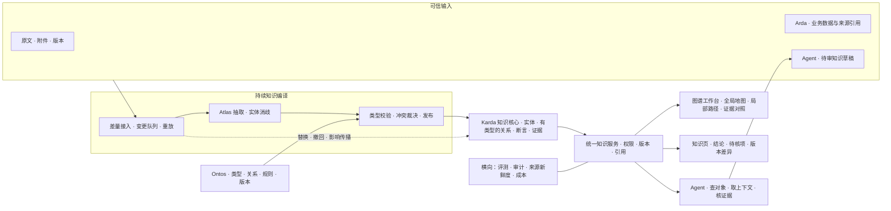

# Karda 知识平台重构：能力图与实施批次

日期：2026-11-24。状态：**owner 已授权设计更新、更新批次并执行**。设计基线为 [160 持续知识架构](../30-design/160-continuous-knowledge-architecture.md)。K0a、K1a 开始本地实施，K0 整批仍待真实评测；本文件不变更平台 I1 暂缓、平台配置和真实客户权限边界，也不把旧业务功能当作已验收。各批实际证据见 §70。

## 10. 产品目标与边界

Karda 将原始材料和业务数据编译成能持续更新的知识资产。**同一份带证据的知识，供 Agent 调用、供人读知识页、供人沿大幅图谱探索。** 第一条产品链路选「招标项目 → 条款 → 资质 → 证明材料」；第二场景用 SOP 新旧版本，验证方法可复用。

- **Ontos** 管版本化的类型、关系、约束和推理规则；**Karda** 管知识实例、断言、时间、证据及发布状态。第一版通过带版本的标准契约和本地样例接线；样例验证不记作 Ontos 联调。有关跨产品实例归属的裁定按 KD-205 流程收口。
- **Arda** 持有结构化业务真值，Karda 保存来源引用和有证据的衍生知识。**Atlas** 提供抽取、向量化、精排和生成能力。**Runos** 可按平台协议分发知识工具，Agent 与图谱依旧复用 Karda 的知识服务与可见范围。
- 复用原文检索、断言/实体/证据/原文片段、确认台、工具入口和现有租户授权；正式重用项由 K0 审计后确认。保留 KD-209 的「原文已验证不代表断言已验证」、KD-211 的独立抽取任务与 KD-222 的确认即收录语义。

## 20. 产品能力图

以下为目标架构。图谱工作台应占据独立大画布；能力图上的后续项按批次启用。

## 30. 先进性及验证办法

LLM Wiki 的工作方式作为重构输入：来源、知识页和维护规则分开；摄取分为分析候选与校验发布；目录和反向链接从已发布资产生成；提供仅原文检索、图谱探索、知识体检和审核回存。按[源码对标与采纳清单](90-llm-wiki-source-benchmark-20261124.md)逐项验收，采用已核对的产品行为与设计，自主实现。

| 设计 | 技术要点 | 可证明的价值 |
| --- | --- | --- |
| 知识随材料演进 | 来源版本、依赖关系、差量编译、幂等键和可重放事件；各层投影可从已发布记录重建 | 更换或撤回一份材料，只影响相关知识；能追溯一次变更所影响的页面、边和结论 |
| 知识可辩护 | 断言挂原文锚点、支持/反驳证据及生效区间；区分来源陈述、人员确认和规则推导 | 能回答「依据哪份资料、哪一版、什么时候有效」；证据不足明确返回不足 |
| 图谱能完成工作 | 图谱服务以语义类型和权限限定路径；全局聚合、按需展开局部；边可打开证据侧栏 | 用户从对象找到证据与冲突；不同权限下节点、边、路径、数量与下载均不泄露 |
| 智能体能可靠取用 | 统一知识包：对象 ID、适用范围、有效时间、状态、证据和缺口；词法/向量保底，按意图选结构查询或图增强 | 多 Agent 复用同一知识；复杂检索与文字基线进行同题对照，记录质量、延迟、模型用量 |
| 本体真的参与运行 | 固定语义版本，确定性校验先于发布；记录规则版本、输入和解释路径 | LLM 提出候选；可执行规则由确定性服务验证；区分推导结果与已验证事实 |

首期用 PostgreSQL 和受限图查询承载；独立图数据库、全局 GraphRAG 归纳、全自动推理按基准和实际负载单独决策。图谱渲染库在 K3 依可访问性、交互性能及维护成本选型。离线评测数据和图谱示例均显式标明来源及类别。

## 40. 批次计划

K0 → K1 → K2 → K3；K4 建立在 K2 的稳定知识服务上，可与 K3 独立验证；K5 汇合 K3/K4，随后 K6。每批以一个可独立验收的 PR 为单位；超出一个 PR 的内容拆子批次，各自产出验收证据。K0 后再估工期，依据依赖到位时间和真实样本质量排期。

执行细分：**K0a** 设计/源码盘点/合成基线脚手架；**K0b** 真实来源、人工标注与独立留出集；
**K1a** 无生产依赖的版本化本体校验与安全图投影；**K1b** DDL/Prisma/数据设计锁步、权威来源和授权适配、发布事务与持久事件回放。
K0a 完成后可验证 K1a；K0b 未完成时不得声称 K0/K1 整批验收，K1b 迁移及 K2 正式接线仍依赖 K0b。

| 批次 | 交付 | 通过条件 |
| --- | --- | --- |
| **K0 · 定范围与基线** | 审计现有模型、工具、权限和可复用路径；冻结招标领域契约草案、样本与评分口径；建立现有文字检索基线、能力图和工作台交互稿 | 版本、来源、答案、证据可对照；覆盖交叉引用、适用时间、未知/冲突、同名对象、权限撤销；记录 Ontos/Atlas/Arda/Runos 责任、依赖和替代验收范围 |
| **K1 · 语义与证据底座** | 版本化 Schema；同库实体解析；最小关系集；断言及边绑定证据；影响索引；增量事件、撤回与回放 | 重复/乱序事件不产生重复边或恢复旧状态；旧版本默认不出现在现行查询；拒绝越权访问和越权推导；重建后知识和人工裁决可核对 |
| **K2 · 可用知识服务** | 抽取候选、类型校验、待审冲突、确认发布；Agent 读取对象/条款/证据及原文回退；知识页作为已发布资产的衍生视图 | 一次 Agent 任务能读到条款、资格、证据和缺口；无证据不作确定结论；来源撤回或权限减少后下一次授权读取不到失效派生内容 |
| **K3 · 大幅图谱工作台** | 全局聚合、对象局部图、按类型筛选、路径追踪、证据侧栏、新旧版本对照；真实数据驱动，含加载、空态和权限状态 | 人能从项目走到证明材料并打开证据；图谱、知识页和 Agent 对同一身份返回相同的可见事实及证据；键盘可导航；验收真实样本和规模样本两类 |
| **K4 · 图增强检索与 Ontos 联调** | 对照文字搜索、实体查询与受限图扩展；接入一个真实 Ontos 版本和一组确定性规则；保留证据链、规则解释及回退策略 | 真实联调、版本变更和回滚可重放；达到复杂任务质量门槛后才默认启用图增强；未达标仍保留文字/实体能力 |
| **K5 · 知识持续运营** | 新旧版本影响视图、知识体检、Agent 草稿回存、可信知识页差量刷新；按权限移除缓存、索引和图投影 | 第二场景 SOP 也可接入；冲突可复核、更新可审计、历史与现行可区分；撤回与权限变化覆盖所有消费面 |
| **K6 · 隔离试点与切换** | 只读影子对照、兼容工具映射、分空间开关、训练与运营指标，回滚演练；按需接真实 Arda/Runos | 指标证据与隔离试点通过后再提发布；切换可关闭新读面且保留人工裁决与来源；生产状态单独留证 |

## 50. 联调和发布门槛

- **硬门槛**：评测及隔离演练中，未授权节点、边、证据及图聚合泄露为零；现行读面返回已撤回或被替代的结论为零；首场景已发布的关键结论全部可定位到可见证据。投影刷新有延迟时，读取路径仍须拒绝失效版本，不能仅靠缓存过期。
- **质量门槛，K0 冻结提议值**：≥60 道脱敏或可公开样例，含 ≥20 道跨文档或多跳题，固定独立留出集；按「结论正确且证据支持」计分。图增强对复杂子集较文字基线提升 ≥10 个百分点，简单题准确率下降不超过 2 个百分点；同时记录拒答准确性、人工复核量与抽取质量。报告样本数、原始计数及误差范围，差异不明确时继续试点。
- **性能门槛，K0 按负载定稿**：以现有检索设计 P95 <700 ms 作为检索接口预算基准；单独度量图查询 P95、首屏图可操作耗时、Atlas 生成和单次任务成本。拟定局部图首屏 ≤2 秒，K0 固定图规模、设备、并发、网络和冷/热缓存口径后确认，不以演示速度替代负载测量。
- **依赖分流**：K0 可做只读审计、样例和原型；后续本地验证用公开或脱敏来源、本体夹具及隔离凭据。真实 Atlas 调用、Ontos 版本发布、Arda 事件、Runos 分发分别记录联调证据，缺一项便标为对应联调待验，不把替身当生产就绪。
- **迁移**：采用新增字段/投影与 API 兼容接入，先本地及隔离回放，再以功能开关切换。K1 记录重放、降级和失效策略；K6 演练关开关与恢复。平台身份、席位、订阅、代用户鉴权与计量契约照现行标准执行。

## 60. 首批实施清单

1. 把现有模型、工具和页面按「复用／适配／替换」登记，记录源码入口和已验证证据。
2. 选定招标文件、新旧补遗、可核对的证明材料及隔离权限场景，整理最小本体和样本标注规范。
3. 冻结 Agent 知识包、图谱查询、证据跳转和变更失效四个接口的初稿；把已发布知识与仅原文模式写入检索契约，确定来源版本、主题页和正反链接的投影关系。
4. 跑出文字检索基线；在交互稿中检验「从项目找到条款、资质和原文」路径，设计知识页与语义图对照组，纳入多来源撤回、结构体检和待审回存场景。
5. 以 K0 验收材料定 K1 的实施范围，记录外部依赖和验收环境。生产发布另按现有流程。

## 70. 执行进度（2026-11-24）

| 项 | 状态 | 实际证据与剩余 |
| --- | --- | --- |
| 设计更新 | LOCAL COMPLETE | 产品定义 v0.6、KD-227–230、160 主设计、110/120/140 增补及设计索引已更新；owner 授权补入执行入口 |
| K0a | LOCAL COMPLETE | [源码审计与接口草案](100-k0-audit-and-contracts-20261124.md)；固定 8 段合成材料、12 道检索冒烟题；[基线报告](100-k0-lexical-smoke-20261124.json) 15/15 个预期资料召回、11/12 题完整命中；未知题出现弱相关结果，尚无生成/拒答验证 |
| K0b | PENDING DATA | 待可公开/脱敏真实资料、人工标注与独立留出集；合成样本不替代本门槛 |
| K1a | LOCAL VERIFIED | app/kb/semantic/ 本体契约和安全现行图投影，20 项新增行为测试通过，TypeScript 通过；全量 906 通过、11 跳过；不含 HTTP/DB 适配，不构成生产安全或端到端验收 |
| K1b | NOT STARTED | 数据设计/DDL/Prisma、权威状态读取、持久化编译发布、并发及事件回放，依赖 K0b 和 K1a |
| K2–K6 | NOT STARTED | 保持本文件 §40 的先后及验收门槛，不因纯函数通过而提前记完成 |

当前原文基线为既有 BM25 组件，不含向量、精排或模型应答，报告不证明图增强收益。
本地代码检查记录在 K0 审计文档，真实平台联调、生产发布和产品切换均未进行。
